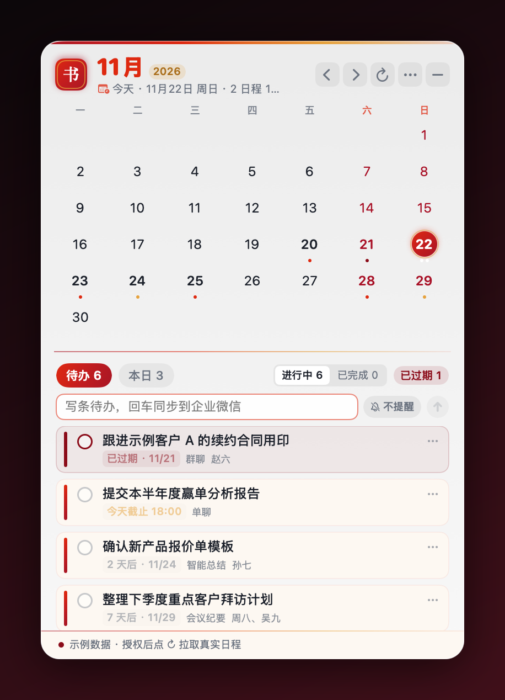

<div align="center">

# 书办 · ShuBan

**常驻 macOS 桌面的办公小助手。贴到屏幕边就收成一条书脊，鼠标移过去立刻展开。**

当前接通企业微信的日程与待办，并且自带一个录屏（主屏 / 选区 / 副屏，带麦克风与点击高亮）和一个记事本（自定义树形目录、可贴图）；会持续往上叠能力，目标是把每天要看的、要办的事收在一个小窗口里。

<sub>macOS 13+ · Swift + SwiftUI · MIT License</sub>

<sub>名字取自「书办」——旧时官署里文案办理的那份差事。贴在屏幕边时它就像一根书脊，摊开是一桌待办。</sub>

</div>



---

## 它现在能做什么

| 能力 | 说明 |
| --- | --- |
| 月历 + 当日安排 | 点任意日期看那天的日程与待办，有安排的日子带圆点（红=日程/已过期，金=待办） |
| 待办列表 | 进行中 / 已完成两个视图，逾期直接标「已过期」，不再让你猜 |
| 行内新建待办 | 底部输入框回车即写入企业微信，可带提醒时间（只标日期或精确到分） |
| 行内编辑 | 勾完成、改截止时间、改名、删除，都在列表行尾「⋯」里，改完立刻落到企业微信 |
| 日程详情 | 会议时间、会议室、地点、参与人 |
| 自动同步 | 默认每 10 分钟静默拉一次；也可以点 ↻ 手动刷新 |
| 到点桌面提醒 | 盖在全屏应用之上，可推迟 1 小时 / 3 小时 / 1 天 / 3 天 / 1 周 |
| 贴边收起 | 贴上屏幕任一边就缩成 14pt 窄条，鼠标压到线上展开，移开立刻缩回 |
| 自由缩放 | 320–768 宽、430–1040 高，字号跟着等比缩放，宽扁和高瘦都不切内容 |
| 单实例 + 自启 | 重复启动会静默退出（避免提醒弹两遍）；可选登录自启 |
| **录屏** | 底栏「录屏」进同一个面板：主屏 / 框选 / 副屏三档，可收麦克风、可开点击高亮、可倒计时；录完自动体检并给「播放 / Finder / 生成分享版」 |
| 录屏不入镜 | 书办自己的面板和录制中的悬浮条都标了 `sharingType = .none`，成片里不会出现（截图对照验证过） |
| **记事本** | 底栏「笔记」进同一个面板：左边的树自己搭（文件夹 / 笔记可任意嵌套，拖动改层级，右键改名、上下移、移到顶层），右边写正文，`⌘V` 直接贴图，点缩略图放大 |
| 笔记全本地 | 存在 `data/notes/`：一份 `notes.json` + `images/`，纯明文、原子写入，拷走就是备份 |

<table>
<tr>
<td width="50%"></td>
<td width="50%"></td>
</tr>
<tr>
<td align="center"><sub>到点提醒：可直接推迟或完成</sub></td>
<td align="center"><sub>贴右边后的窄条：左边是原比例，右边放大 3 倍</sub></td>
</tr>
</table>

<div align="center">


<sub>录屏不是一个额外窗口，就是从底栏那颗红点进来的同一个面板</sub>

</div>

<div align="center">


<sub>记事本：左边自己搭目录树，右边写正文，⌘V 直接贴图</sub>

</div>

## 快速开始

**依赖**：macOS 13+、Xcode 命令行工具（`swiftc`）、Python 3、[企业微信 CLI](https://developer.work.weixin.qq.com/)（`wecom-cli`，用于取数）

先不接企业微信，用示例数据看界面：

```bash
git clone https://github.com/zhanggefei/shuban.git
cd shuban
python3 make_demo_data.py     # 写入一份示例数据（结构和真实数据一致）
./build.sh                    # 编译到 build/书办.app
open build/书办.app
```

接真实数据：

```bash
wecom-cli auth show           # 确认已授权（Status: authorized）
./refresh.sh                  # 拉取日程 + 待办，写入 data/data.json
```

> 企业微信机器人需要分别开通「日程」和「待办」的权限。权限没开时界面会显示 `850003` 并给出提示，不会把已有数据刷空。

开机自启（可选，会额外装一个 30 分钟的定时刷新，小组件自己已经每 10 分钟同步，一般不需要）：

```bash
./install_autostart.sh            # 安装
./install_autostart.sh uninstall  # 卸载
```

## 目录结构

```
build.sh              编译并打包成 .app（含 Info.plist、签名、图标）
refresh.sh            一键拉数据（补 PATH，解决从 Dock 启动找不到 wecom-cli）
fetch_data.py         调 wecom-cli 取日程/待办 → data/data.json
add_todo.py           新建待办（写企业微信 + 乐观合并本地快照）
edit_todo.py          完成 / 改截止 / 恢复未完成
make_demo_data.py     生成示例数据
install_autostart.sh  登录自启 + 定时刷新（LaunchAgent）
src/main.swift        主面板、日历、待办、贴边收起、自动同步
src/Reminder.swift    桌面提醒窗口
src/Recorder.swift    录屏引擎（screencapture 子进程、阶梯停止、成片体检、分享版压缩）
src/RecordPanel.swift 录屏面板（书办视觉，和日程/待办并列的另一个面板态）
src/NoteStore.swift   记事本数据层（扁平节点表 + parent 指针、防抖落盘、图片归集）
src/NotePanel.swift   记事本面板（目录树 + 编辑器 + 贴图）
data/data.json        本地数据快照（不入库）
data/notes/           记事本数据：notes.json + images/（不入库）
```

## 几个绕不开的设计取舍

这些是踩了坑之后定下来的，改之前值得先读一遍：

1. **不用 WidgetKit，自建 NSPanel 浮窗。** WidgetKit 的沙箱里调不了企业微信 CLI，只能靠主 App 取数；而小组件要的是「随时可点、可输入、可提醒」，浮窗反而更合适。
2. **窗口尺寸自己存（`wecal.frame`），不用 `setFrameAutosaveName`。** NSWindow 的 autosave 在每次 frame 变化时都写，收缩成 14pt 窄条那一刻也会写进去 —— 退出时正收着，下次启动窗口就只有 14 像素宽。现在只在展开态保存，并设了宽高下限。
3. **界面必须有时间驱动。** SwiftUI 的 body 只在 `@Published` 变化时重算，`Date()` 算出来的「已过期」不会自己翻新。所以每 5 秒推一次 `clock`，所有时效性文案都读它。
4. **接口偶发返回空要挡住。** 有数据变没数据时先重试一次，仍为空就沿用上次快照并标记 `stale`；全部模块都失败时干脆不覆盖旧文件 —— 否则一次异常刷新能让界面永久变空。
5. **提醒扫描窗口收得很窄（`-600s, +2s`）。** 轮询 5 秒一次，宁可错过 10 分钟内补发，也不要提前弹。
6. **单实例闸门按 bundle id 比对 pid。** 已提醒记录只在启动时读一次，两份进程各持一份就会同一条提醒弹两遍。
7. **录屏用 `screencapture` 子进程，停止必须走 SIGINT → SIGTERM → SIGKILL 阶梯。** SIGINT 能让它把 moov 写全；一旦上到 SIGKILL，系统采集会话释放不掉，之后**所有**录屏（包括别的软件）都会变成黑屏或直接不出文件，只能注销重登。所以强杀要标记出来并明确告知用户。
8. **录制期间文件恒为 0 字节，不能用体积判活。** `screencapture -v` 是「停止时才封装写出」，中途去看文件永远 0 字节。判活只能看进程 CPU 时间增量（录制满 10 秒后增量仍贴着 0 才算卡死）。
9. **自家界面不入镜只认 `NSWindow.sharingType = .none`。** 这是系统给「本机看得见、录屏拿不到」留的正门。验证方式必须是同一窗口、同一位置的对照：标 `.readOnly` 时能录进去、标 `.none` 时录不进去，缺一半就不算验过。
10. **屏幕录制权限要以本应用身份申请。** 子进程 `screencapture` 不会触发授权弹窗，系统也不会把书办登记进「屏幕录制」列表，用户根本找不到可勾的项。必须主进程调 `CGRequestScreenCaptureAccess()`；而且**授权后不重启不生效**。另外 ad-hoc 签名每次重新 `./build.sh` 都会变，改完代码若提示没权限，去系统设置里把「书办」移除再重新添加即可。
11. **「重启书办」不能在本进程里 sleep 完再拉开自己。** `NSApp.terminate` 是同步的，`applicationWillTerminate` 一返回进程就 exit，后台队列里等 1 秒的那个 block 会被一起带走 —— 只有退出流程恰好超过 1 秒那次才重启得起来，表现是「有时能重启、有时点了一点反应都没有」。正确做法是起一个 `/bin/sh` 子进程，用 `kill -0` 轮询本 pid 消失后再 `open -n`：子进程被 launchd 收养，不受父进程退出影响。重启回来还要落在录屏页（`shuban.reopenMode` 一次性键），否则回到日历页看不出重启成功。
12. **`screencapture` 的 `-V` / `-D` 数值必须紧贴。** `-V 2` 会被解析成「`-V` 没有值 + `2` 当输出文件名」，既不限时、又把片子写到名为 `2` 的地方，进程永不退出：自检永远卡在「正在录…」、强杀后一个文件都没有。实测 `-V 2` 8 秒无文件，`-V2` 2 秒正常出片。`-R` 分开写可用，保持原样。
13. **麦克风没授权就绝对不能带 `-g` 起采集。** 授权弹窗挂着时 `screencapture -g` 会一直不退出，正式录制的表现就是「停止后文件不存在、stderr 为空」。现在开录前先问一次授权，未决定就等用户点掉弹窗（最多 25 秒），拒绝或超时则自动降级成「只录画面」并在界面上直说。
14. **签名必须用固定身份，不能每次 ad-hoc。** ad-hoc 签名的 designated requirement 就是「cdhash 相等」，改一行代码重新编译就等于换了个应用，屏幕录制 / 麦克风授权立刻作废 —— 而系统设置里那条「书办」还勾着，于是出现「明明勾着、说没权限、重启也没用」的死结。现在 `build.sh` 优先用本机自签证书 `ShuBan Local Signing`（DR 变成 `identifier + 证书指纹`，重编译不动它），没有该证书才退回 ad-hoc。自己造一张：
    ```sh
    openssl req -x509 -newkey rsa:2048 -nodes -keyout key.pem -out cert.pem -days 3650 \
      -subj "/CN=ShuBan Local Signing" -addext "extendedKeyUsage=critical,codeSigning" \
      -addext "basicConstraints=critical,CA:true"
    openssl pkcs12 -export -inkey key.pem -in cert.pem -out id.p12 -passout pass:shuban \
      -certpbe PBE-SHA1-3DES -keypbe PBE-SHA1-3DES -macalg sha1
    security import id.p12 -k ~/Library/Keychains/login.keychain-db -P shuban -T /usr/bin/codesign
    security add-trusted-cert -r trustRoot -k ~/Library/Keychains/login.keychain-db cert.pem
    ```
    （`-certpbe/-keypbe/-macalg` 不能省，OpenSSL 3 默认参数 macOS 的 `security import` 读不了，会报 MAC verification failed。）历史遗留的僵尸授权记录用 `tccutil reset ScreenCapture com.zhanggefei.shuban` 清掉再授权。
15. **验权限别用 shell 直跑 bundle 里的可执行文件。** `./build/书办.app/Contents/MacOS/ShuBan` 这样直接 exec 时，TCC 会把权限算在**父进程**（终端 / 宿主应用）头上，`CGPreflightScreenCaptureAccess()` 读到的是终端的授权，于是「有权限」是假象。要用 `open -n --env WECAL_REC_CHECK=1 build/书办.app` 让 LaunchServices 拉起，结论会写进 `data/ui.log`（stdout 拿不到）。
16. **底栏那个回车监视器必须按页面豁免。** 为了治「输入法还没上屏就按回车」，装了一个本地按键监视器接管 Return。它认的是「首响应者是 NSTextView 就吞掉」，而记事本正文的 `TextEditor` 底下正好也是一个 NSTextView —— 不豁免的话正文永远打不出第二段。现在 `store.mode == 2` 直接放行，并且有 `WECAL_NOTES_ENTER_TEST=1` 真投一个回车来验（去掉那行 guard，用例会立刻变红；这是验过对照的）。
17. **笔记树存成扁平表 + `parent` 指针，不存嵌套结构。** 改名、移动、删除都只改一行字段，不用递归拷贝子树；JSON 结构也永远是稳定的两层，层级再深也不会出现递归解码的坑。取树时按 `parent` 现算（几十上百个节点毫无压力）。展开状态跟着 `notes.json` 一起存，谁把哪个文件夹打开了，下次进来还开着。


## 调试与离屏验收开关

没有 GUI 自动化也能验界面，全部走环境变量（因为透明浮窗在锁屏/无头环境里截不到图）：

| 变量 | 作用 |
| --- | --- |
| `WECAL_SIZE=384x560` | 指定内容尺寸启动 |
| `WECAL_SNAP_MAIN=/tmp/m.png` | 把主面板离屏渲染成 PNG，配合 `_FRAMES` / `_STEP` 连拍 |
| `WECAL_SNAP_WINDOWS=/tmp/w.png` | 逐个可见窗口拍图（弹层是独立窗口，主面板钩子拍不到） |
| `WECAL_SNAP=/tmp/r.png` | 拍提醒卡 |
| `WECAL_TEST_REMINDER=1\|2` | 启动即弹日程卡 / 待办卡 |
| `WECAL_OPEN_PANEL=1\|2` | 启动即打开改期面板（只标日期 / 带时刻） |
| `WECAL_PEEK_TEST=1\|2\|3` | 贴边收起：贴右 / 收起再展开 / 贴顶（验窄条版式） |
| `WECAL_PEEK_TEST=4` | 用假坐标跑贴边几何判定的用例表（真机鼠标伪造不了，但规则能钉死） |
| `WECAL_SYNC_MINUTES=3` | 覆盖自动同步间隔 |
| `WECAL_ALLOW_MULTI=1` | 放行多实例（验收时需要同时跑两份） |
| `WECAL_MODE=1` | 启动即打开录屏面板 |
| `WECAL_REC_CHECK=1` | 无界面跑一遍录屏自检（录 2 秒测试片段 + 验画面/麦克风），结论打到 stdout 后退出 |
| `WECAL_REC_TEST=6` | 自动开录 6 秒、停、体检，结果打到 stdout 后退出（验整条链路） |
| `WECAL_REC_SHOW=1` | 对照用：录制期间把面板切回可被采集，它**应该**出现在成片里 |
| `WECAL_REC_DEBUG=1` | 打印采集参数、输出目录可写性、停止阶梯的每步结果 |
| `WECAL_RELAUNCH_TEST=1` | 启动 2.5 秒后真点一次「重启书办」，验旧进程退出 + 新进程被拉起（用 `/tmp/shuban_relaunch_test.mark` 防循环） |
| `WECAL_MODE=2` | 启动即打开记事本 |
| `WECAL_NOTES_TEST=1` | 记事本数据层用例表（30 条，临时目录里跑，不建窗口） |
| `WECAL_NOTES_ENTER_TEST=1` | 在正文里真按一次回车，验它变成换行而不是被底栏那个回车监视器吃掉 |
| `WECAL_NOTES_DIR=/tmp/x` | 把笔记目录指到别处（拍图、试拖动时用，不碰真实笔记） |
| `WECAL_NOTES_PICK=关键词` | 启动即按标题选中某条笔记（拍图不用手点） |

## 路线图

- [ ] **审批（只读）** —— 需要企业自建应用 + 审批数据权限 + 可信 IP 才能调 `oa/getapprovalinfo`
- [ ] 邮件摘要：未读重要邮件进副面板
- [ ] 会议开始前 N 分钟自动提示，一键进会议
- [ ] 更多数据源按同一套 `data.json` 契约接入

## 隐私

- 数据只存在你本机的 `data/data.json`，除企业微信官方接口外不做任何上传。
- 仓库里不含任何真实日程、待办或人名，`data/` 与日志都在 `.gitignore` 里；示例数据是脚本生成的占位内容。

## 许可证

[MIT](LICENSE) —— 随便用，商用、改、二次分发都行，保留版权声明即可。

版本之间的变化见 [CHANGELOG.md](CHANGELOG.md)。

个人项目，作者 **zhanggefei@126.com**。如果它对你有用，**点个 ⭐ 就是最好的鼓励**。
