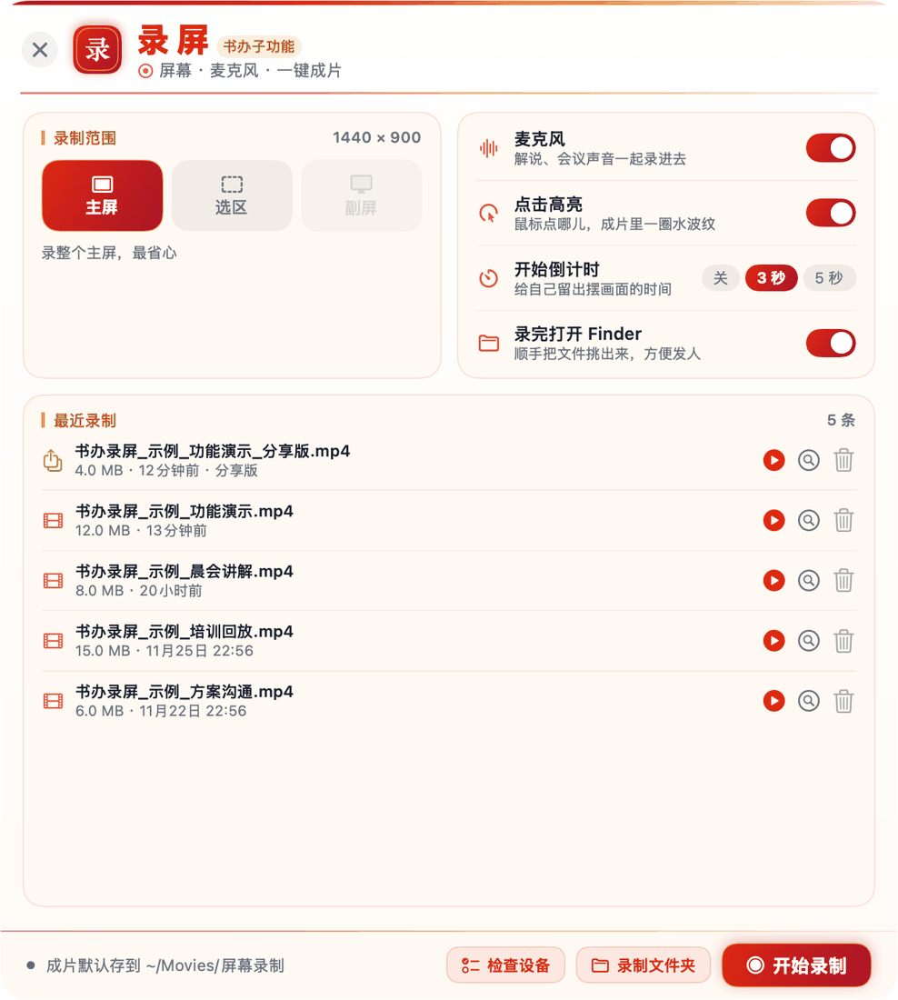
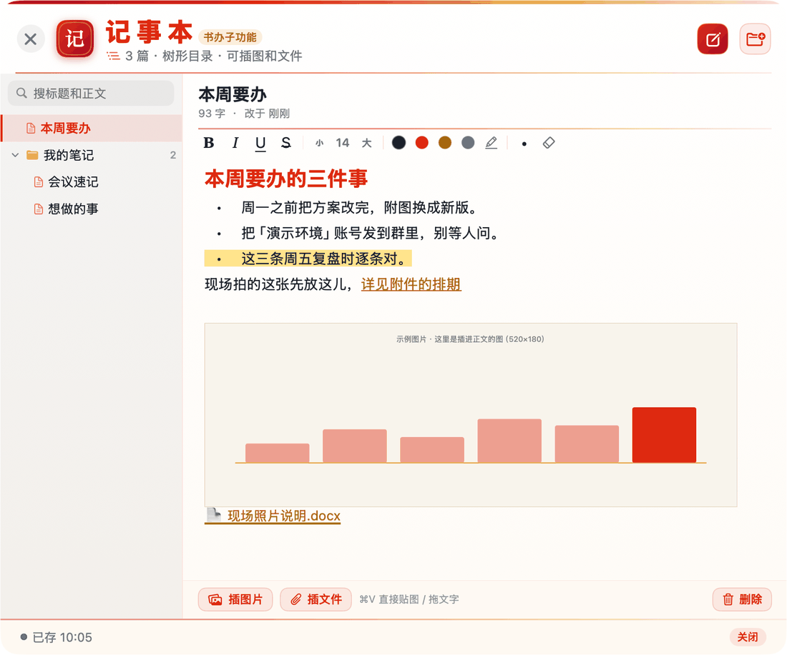
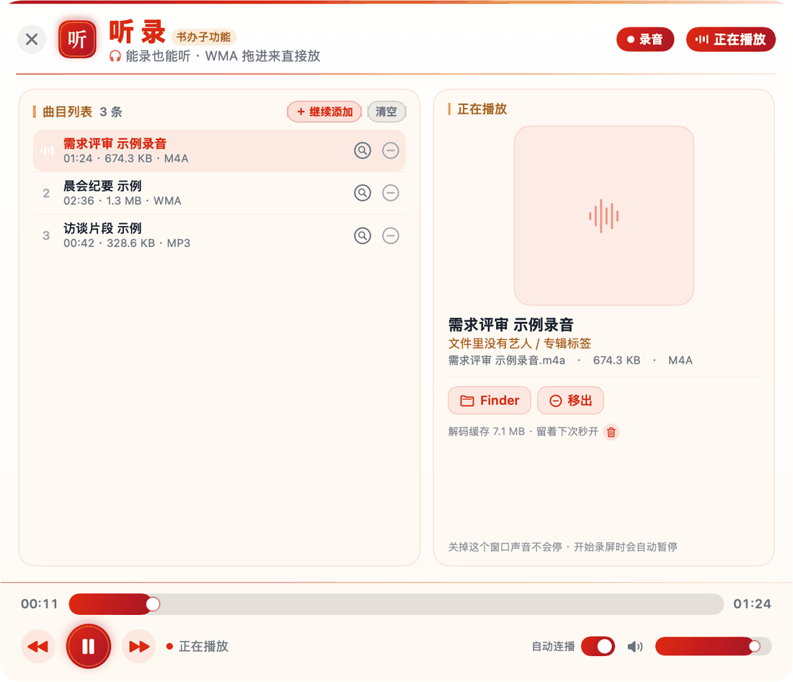
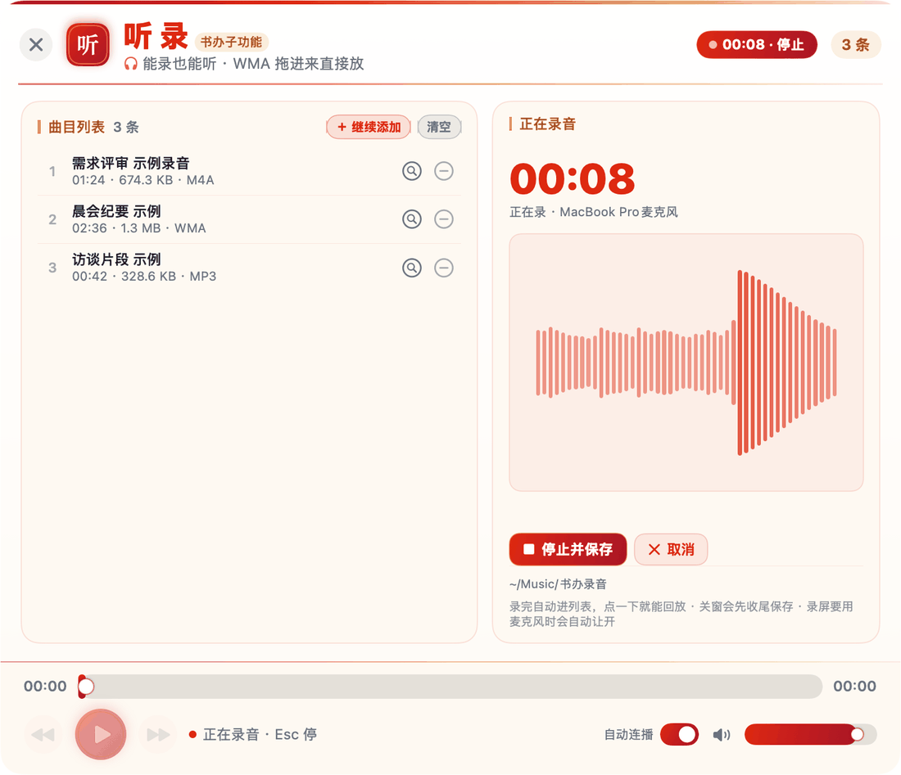

<div align="center">

# 书办 · ShuBan

**常驻 macOS 桌面的办公小助手。日历与待办收在一个 384 宽的小窗口里，录屏、记事本、听录各自弹自己的窗口。**

当前接通企业微信的日程与待办，并且自带录屏（主屏 / 选区 / 副屏，带麦克风与点击高亮）、记事本（自定义树形目录、正文里直接插图和文件）、听录（现录一段，或把 WMA 拖进来听）三个子功能；会持续往上叠能力，目标是把每天要看的、要办的事都收进同一个应用。日历窗保持小而常驻，子功能要多大就给多大 —— 入口在日历窗顶部的「功能」那颗，也可以直接 ⌘2 / ⌘3 / ⌘4。

<sub>macOS 13+ · Swift + SwiftUI · MIT License</sub>

<sub>名字取自「书办」——旧时官署里文案办理的那份差事。窗口收窄时像一根书脊，摊开是一桌待办。</sub>

</div>


---

## 它现在能做什么

| 能力 | 说明 |
| --- | --- |
| 月历 + 当日安排 | 点任意日期看那天的日程与待办，有安排的日子带圆点（红=日程/已过期，金=待办） |
| 待办列表 | 进行中 / 已完成两个视图，逾期直接标「已过期」，不再让你猜 |
| 行内新建待办 | 底部输入框回车即写入企业微信，可带提醒时间（只标日期或精确到分） |
| 行内编辑 | 勾完成、改截止时间、改名、删除，都在列表行尾「⋯」里，改完立刻落到企业微信 |
| 复制粘贴 / 撤销 | 记事本正文、待办输入框、搜索框一律吃 `⌘X ⌘C ⌘V ⌘A ⌘Z ⇧⌘Z`；正文里 `⌘V` 遇到图片仍然走贴图，不粘成文字（这两个坑都是「看着像坏了」那一类，见取舍 25） |
| 日程详情 | 会议时间、会议室、地点、参与人 |
| 自动同步 | 默认每 10 分钟静默拉一次；也可以点 ↻ 手动刷新 |
| 到点桌面提醒 | 盖在全屏应用之上，可推迟 1 小时 / 3 小时 / 1 天 / 3 天 / 1 周 |
| 自由缩放 | 日历窗 320–768 宽、430–1040 高，字号跟着等比缩放，宽扁和高瘦都不切内容；子功能窗口各有自己的宽高范围与字号，互不牵制 |
| 单实例 + 自启 | 重复启动会静默退出（避免提醒弹两遍）；可选登录自启 |
| **录屏** | 独立窗口（默认 620×690，可拉 600×520 ~ 900×1000），横版两栏：左「录制范围」、右「麦克风 / 点击高亮 / 倒计时 / 录完打开 Finder」，下半区是最近成片，主按钮沉在右下角。主屏 / 框选 / 副屏三档，录完自动体检并给「播放 / Finder / 生成分享版」；每一行都能删（二次确认后进废纸篓，连分享版一起收），文件在别处被删掉时这一行会自己消失；删空了留一行「还没有成片」，不会整块塌掉。入口是日历窗顶部的「功能」，或 ⌘2 |
| 录屏不入镜 | 书办自己的面板和录制中的悬浮条都标了 `sharingType = .none`，成片里不会出现（截图对照验证过） |
| **记事本** | 独立窗口（默认 780×640，最宽 1200）：左边的树自己搭（文件夹 / 笔记可任意嵌套，拖动改层级，右键改名、上下移、移到顶层），右边写正文，图片和文件都插在光标处、跟着文字走。入口同上，或 ⌘3 |
| 图在正文里 | 插图不再是正文底下另起一条缩略图带 —— 图片就是正文里的一个字符，夹在段落之间，跟文字一起排版、一起滚动、一起复制；宽度按 520 封顶等比缩，选中删掉就真删掉。`⌘V` 贴图按光标位置落（光标在搜索框里则落到正文末尾，不会把图贴进搜索词）；工具条的「插图片」也是插在光标处 |
| 插文件 | 「插文件」选一个本机文件，正文里落一枚金色 📄 芯片（文件名带下划线），点一下就按系统默认应用打开。**文件实体不进正文、也不进笔记包**，只复制到 `data/notes/files/`（同名自动加「 2」），正文里记住的是名字；文件名带 `/`、`\`、`..`、以 `.` 开头的一律不认，打开前还会再校验路径没跑出那个目录 —— 一条笔记的正文没法变成「读走你任意一个文件」的入口 |
| 富文本 | 正文顶上一排格式条：粗 / 斜 / 下划线 / 删除线、字号五档（11 / 12.5 / 14 / 17 / 21 / 26）、四档字色（墨 / 红 / 金 / 灰）+ 高亮、项目符号、清除格式；快捷键 ⌘B ⌘I ⌘U ⇧⌘X ⌘\ 挂在「格式」菜单上，⌘Z 能撤。**粘贴一律洗一遍**：外来字号吸附到最近的档、颜色归到那四档（深色网页的白字归墨，否则在宣纸底上看不见）、外来底色丢掉、字体家族换成系统字体 —— 从网页 / 微信粘一段过来不会带进一块块读不清的白字。老笔记不用迁移，打开时按纯文本现长一份格式（见取舍 26）|
| 笔记全本地 | 存在 `data/notes/`：一份 `notes.json`（正文的纯文本投影，搜索和字数靠它）+ `rich/<id>.rtfd/`（带格式和正文里那些图的那份）+ `files/`（插进来的文件）。都是普通文件、没有私有格式，拷走就是备份；`notes.json` 坏了会先另存成 `notes.bad.json` 再重建，不会一崩全丢 |
| **听录** | 独立窗口（默认 720×620，可拉 620×520 ~ 1100×1000）：左边曲目列表（拖进来或点「＋ 添加」，WMA / MP3 / WAV / M4A / FLAC 等二十来种后缀），右边正在播放（封面、标签、解码缓存），底下一条进度条 + 上一首 / 播放 / 下一首 + 自动连播 + 音量。入口同上，或 ⌘4。**关掉窗口声音不会停** —— 挂着头听边干活才是它的用法；唯一会自动暂停的地方是开始录屏，因为外放会被麦克风收进成片 |
| 听录也管录 | 同一扇窗右上角「● 录音」：点一下开录（AAC 单声道 44.1k，落 `~/Music/书办录音`），窗里换成大计时 + 实时电平波形 + 「停止并保存 / 取消」，`Esc` 即停。录完自动进列表并选中，但**不会自己出声**；少于 0.6 秒的直接丢掉，不留垃圾文件。**关窗会先把录音收尾保存**（录到的保住，只停不删），录屏正在用麦克风时起录会被明确挡住并说明原因 |
| 听录不碰原件 | 播放列表只存路径和顺序（`data/listen/playlist.json`），「移出」只摘行，**不删你盘上的录音**；解码结果落在 `~/Library/Caches/书办/听录`，最多留 5 条，随时能一键清掉 |

<div align="center">


<sub>到点提醒：盖在全屏应用之上，可直接推迟或完成</sub>

</div>

<div align="center">



<sub>录屏：日历窗顶部「功能」→ 录屏（或 ⌘2），弹自己的窗口，布局按录屏需要排</sub>

</div>

<div align="center">



<sub>记事本：独立窗口才装得下「树 + 正文」两栏，左边自己搭目录树，右边写正文 —— 正文顶上那排是格式条，粗斜下划删除线、五档字号、四档字色、高亮、项目符号、清除格式；图在正文里跟着文字走（中间那张就是插进去的），文件是最后一行那枚金色 📄 芯片，点一下就用默认应用打开</sub>

</div>

<div align="center">



<sub>听录：系统播不动的 .wma 录音拖进来就能听，进度随便拖、播完自动接下一条；关掉窗口声音继续放（图里是脚本生成的示例录音）</sub>

</div>

<div align="center">



<sub>听录 · 录音态：点「● 录音」就地换成录音台 —— 大计时、实时电平、停止并保存 / 取消，`Esc` 也能停；录到的存进 `~/Music/书办录音` 并自动进列表</sub>

</div>

## 快速开始

**依赖**：macOS 13+、Xcode 命令行工具（`swiftc`）、Python 3、[企业微信 CLI](https://developer.work.weixin.qq.com/)（`wecom-cli`，用于取数）

先不接企业微信，用示例数据看界面：

```bash
git clone https://github.com/zhanggefei/shuban.git
cd shuban
python3 make_demo_data.py     # 写入一份示例数据（结构和真实数据一致）
./build.sh                    # 编译到 build/书办.app
open build/书办.app
```

接真实数据：

```bash
wecom-cli auth show           # 确认已授权（Status: authorized）
./refresh.sh                  # 拉取日程 + 待办，写入 data/data.json
```

> 企业微信机器人需要分别开通「日程」和「待办」的权限。权限没开时界面会显示 `850003` 并给出提示，不会把已有数据刷空。

开机自启（可选，会额外装一个 30 分钟的定时刷新，小组件自己已经每 10 分钟同步，一般不需要）：

```bash
./install_autostart.sh            # 安装
./install_autostart.sh uninstall  # 卸载
```

## 目录结构

```
build.sh              编译并打包成 .app（含 Info.plist、签名、图标）
refresh.sh            一键拉数据（补 PATH，解决从 Dock 启动找不到 wecom-cli）
fetch_data.py         调 wecom-cli 取日程/待办 → data/data.json
add_todo.py           新建待办（写企业微信 + 乐观合并本地快照）
edit_todo.py          完成 / 改截止 / 恢复未完成
make_demo_data.py     生成示例数据
install_autostart.sh  登录自启 + 定时刷新（LaunchAgent）
src/main.swift        日历窗、待办、窗口工厂、自动同步
src/FeatureWindow.swift 子功能窗口的定义层（录屏/记事本各自的标题、尺寸、存档键 + 关闭动作）
src/Reminder.swift    桌面提醒窗口
src/Recorder.swift    录屏引擎（screencapture 子进程、阶梯停止、成片体检、分享版压缩）
src/RecordPanel.swift 录屏窗口内容（自带字号档 PZ/PF，不跟日历窗抢缩放）
src/NoteStore.swift   记事本数据层（扁平节点表 + parent 指针、防抖落盘、RTFD 包存取、附件文件归集）
src/RichText.swift    富文本层（字号阶梯、四档颜色、粘贴洗白、RTFD 往返、图与文件芯片、格式操作的唯一实现处）
src/NotePanel.swift   记事本窗口内容（目录树 + 编辑器 + 格式条 + 插图插文件）
src/AudioBoard.swift  听录引擎（ffmpeg 探测与解码、WAV 缓存与 LRU、播放状态机、录音收尾接线）
src/AudioCapture.swift 录音引擎（AVAudioRecorder、授权等待、电平与计时、太短就丢）
src/AudioPanel.swift  听录窗口内容（曲目列表 + 正在播放 / 正在录音 + 播放条，自带 1.2 字号档）
data/data.json        本地数据快照（不入库）
data/notes/           记事本数据：notes.json + rich/（每篇一个 rtfd 包，图在包里）+ files/（插进来的文件，都不入库）
data/listen/          听录播放列表 playlist.json（解码缓存在 ~/Library/Caches/书办/听录，都不入库）
```

## 几个绕不开的设计取舍

这些是踩了坑之后定下来的，改之前值得先读一遍：

1. **不用 WidgetKit，自建 NSPanel 浮窗。** WidgetKit 的沙箱里调不了企业微信 CLI，只能靠主 App 取数；而小组件要的是「随时可点、可输入、可提醒」，浮窗反而更合适。
2. **窗口尺寸自己存（`wecal.frame`），不用 `setFrameAutosaveName`。** NSWindow 的 autosave 在每次 frame 变化时都写，保存时机完全不受控（曾经因此把窗口存成过 14 像素宽）。现在自己写，带 0.6 秒防抖，并设了宽高下限。
3. **界面必须有时间驱动。** SwiftUI 的 body 只在 `@Published` 变化时重算，`Date()` 算出来的「已过期」不会自己翻新。所以每 5 秒推一次 `clock`，所有时效性文案都读它。
4. **接口偶发返回空要挡住。** 有数据变没数据时先重试一次，仍为空就沿用上次快照并标记 `stale`；全部模块都失败时干脆不覆盖旧文件 —— 否则一次异常刷新能让界面永久变空。
5. **提醒扫描窗口收得很窄（`-600s, +2s`）。** 轮询 5 秒一次，宁可错过 10 分钟内补发，也不要提前弹。
6. **单实例闸门按 bundle id 比对 pid。** 已提醒记录只在启动时读一次，两份进程各持一份就会同一条提醒弹两遍。
7. **录屏用 `screencapture` 子进程，停止必须走 SIGINT → SIGTERM → SIGKILL 阶梯。** SIGINT 能让它把 moov 写全；一旦上到 SIGKILL，系统采集会话释放不掉，之后**所有**录屏（包括别的软件）都会变成黑屏或直接不出文件，只能注销重登。所以强杀要标记出来并明确告知用户。
8. **录制期间文件恒为 0 字节，不能用体积判活。** `screencapture -v` 是「停止时才封装写出」，中途去看文件永远 0 字节。判活只能看进程 CPU 时间增量（录制满 10 秒后增量仍贴着 0 才算卡死）。
9. **自家界面不入镜只认 `NSWindow.sharingType = .none`。** 这是系统给「本机看得见、录屏拿不到」留的正门。验证方式必须是同一窗口、同一位置的对照：标 `.readOnly` 时能录进去、标 `.none` 时录不进去，缺一半就不算验过。
10. **屏幕录制权限要以本应用身份申请。** 子进程 `screencapture` 不会触发授权弹窗，系统也不会把书办登记进「屏幕录制」列表，用户根本找不到可勾的项。必须主进程调 `CGRequestScreenCaptureAccess()`；而且**授权后不重启不生效**。另外 ad-hoc 签名每次重新 `./build.sh` 都会变，改完代码若提示没权限，去系统设置里把「书办」移除再重新添加即可。
11. **「重启书办」不能在本进程里 sleep 完再拉开自己。** `NSApp.terminate` 是同步的，`applicationWillTerminate` 一返回进程就 exit，后台队列里等 1 秒的那个 block 会被一起带走 —— 只有退出流程恰好超过 1 秒那次才重启得起来，表现是「有时能重启、有时点了一点反应都没有」。正确做法是起一个 `/bin/sh` 子进程，用 `kill -0` 轮询本 pid 消失后再 `open -n`：子进程被 launchd 收养，不受父进程退出影响。重启回来还要落在原来那个窗口（`shuban.reopenPane` 一次性键，90 秒有效），否则从录屏窗重启却回到日历窗，看不出重启成功。
12. **`screencapture` 的 `-V` / `-D` 数值必须紧贴。** `-V 2` 会被解析成「`-V` 没有值 + `2` 当输出文件名」，既不限时、又把片子写到名为 `2` 的地方，进程永不退出：自检永远卡在「正在录…」、强杀后一个文件都没有。实测 `-V 2` 8 秒无文件，`-V2` 2 秒正常出片。`-R` 分开写可用，保持原样。
13. **麦克风没授权就绝对不能带 `-g` 起采集。** 授权弹窗挂着时 `screencapture -g` 会一直不退出，正式录制的表现就是「停止后文件不存在、stderr 为空」。现在开录前先问一次授权，未决定就等用户点掉弹窗（最多 25 秒），拒绝或超时则自动降级成「只录画面」并在界面上直说。
14. **签名必须用固定身份，不能每次 ad-hoc。** ad-hoc 签名的 designated requirement 就是「cdhash 相等」，改一行代码重新编译就等于换了个应用，屏幕录制 / 麦克风授权立刻作废 —— 而系统设置里那条「书办」还勾着，于是出现「明明勾着、说没权限、重启也没用」的死结。现在 `build.sh` 优先用本机自签证书 `ShuBan Local Signing`（DR 变成 `identifier + 证书指纹`，重编译不动它），没有该证书才退回 ad-hoc。自己造一张：
    ```sh
    openssl req -x509 -newkey rsa:2048 -nodes -keyout key.pem -out cert.pem -days 3650 \
      -subj "/CN=ShuBan Local Signing" -addext "extendedKeyUsage=critical,codeSigning" \
      -addext "basicConstraints=critical,CA:true"
    openssl pkcs12 -export -inkey key.pem -in cert.pem -out id.p12 -passout pass:shuban \
      -certpbe PBE-SHA1-3DES -keypbe PBE-SHA1-3DES -macalg sha1
    security import id.p12 -k ~/Library/Keychains/login.keychain-db -P shuban -T /usr/bin/codesign
    security add-trusted-cert -r trustRoot -k ~/Library/Keychains/login.keychain-db cert.pem
    ```
    （`-certpbe/-keypbe/-macalg` 不能省，OpenSSL 3 默认参数 macOS 的 `security import` 读不了，会报 MAC verification failed。）历史遗留的僵尸授权记录用 `tccutil reset ScreenCapture com.zhanggefei.shuban` 清掉再授权。
15. **验权限别用 shell 直跑 bundle 里的可执行文件。** `./build/书办.app/Contents/MacOS/ShuBan` 这样直接 exec 时，TCC 会把权限算在**父进程**（终端 / 宿主应用）头上，`CGPreflightScreenCaptureAccess()` 读到的是终端的授权，于是「有权限」是假象。要用 `open -n --env WECAL_REC_CHECK=1 build/书办.app` 让 LaunchServices 拉起，结论会写进 `data/ui.log`（stdout 拿不到）。
16. **回车监视器必须按窗口认人，不能按「有没有文本框」认人。** 为了治「输入法还没上屏就按回车」，装了一个本地按键监视器接管 Return。它原本认「首响应者是 NSTextView 就吞掉」，而记事本正文的 `TextEditor` 底下正好也是一个 NSTextView —— 一顺手就把正文的回车吃掉，第二段永远打不出来。记事本拆成独立窗口之后，守卫改成只看事件的 `window` 是不是日历窗，别的窗口一律放行。这条验过对照：把守卫换成「哪个窗口有 NSTextView 就管哪个」，`WECAL_NOTES_ENTER_TEST=1` 立刻从 ✓ 变红（正文停在「第一行」）。
17. **笔记树存成扁平表 + `parent` 指针，不存嵌套结构。** 改名、移动、删除都只改一行字段，不用递归拷贝子树；JSON 结构也永远是稳定的两层，层级再深也不会出现递归解码的坑。取树时按 `parent` 现算（几十上百个节点毫无压力）。展开状态跟着 `notes.json` 一起存，谁把哪个文件夹打开了，下次进来还开着。
18. **不做贴边自动收起。** 做过一版：贴到屏幕任一边就缩成 14pt 窄条、鼠标压上去再展开。规则能算准（几何判定抽成纯函数钉了 20 多条用例），但手动拖窗口时只要靠近边缘就触发，想把它摆在边角反而总被收走，日常用起来是负担。因此整套删掉，包括窄条布局、悬停轮询、拖拽方向判定和那个开关。窗口位置仍然记，但不再对「贴到哪」做任何自动响应。
19. **子功能是独立窗口，不挤在日历窗的一个「态」里。** 原先录屏和记事本靠 `store.mode` 在同一个 384 宽的面板里翻页，结果是两件事同时坏了：记事本的「树 + 正文」两栏根本塞不进 384 宽，录屏的档位、开关、最近列表也只能竖着堆成一长条；而且日历窗的字号档是按自己宽度算出来的全局值，子页面一 inherit 就被带着缩放。现在一个功能一个 `NSPanel`：各自的默认尺寸、上下限、存档键（`wecal.frame` / `wecal.frame.record` / `wecal.frame.notes` / `wecal.frame.audio`）、以及文件内私有的一份字号（录屏 1.15 档、记事本 1.25 档、听录 1.2 档），拖哪一个都不影响另外三个。关掉只是 `orderOut`，窗口对象留着，再打开时选中的笔记、滚到的位置都还在。入口换成日历窗顶部的「功能」胶囊 + ⌘1/⌘2/⌘3/⌘4 + 状态栏菜单（带勾选态），底栏退回它该干的事 —— 只报同步状态。验收见 `WECAL_FEATURE_TEST=1`（50 条：菜单键位、每个窗口的尺寸上下限、关掉再开是否复用同一个窗口对象、改一个窗的尺寸会不会带走日历窗的字号档、三个子窗的底色是否不透桌面、最近录制那一列的排序/删除/分享版连带、存档恢复按各窗自己的上下限而不是日历窗的 768）。
20. **透明窗口必须自己铺满底，否则一片透。** NSPanel 为了圆角外面不出现灰底，设了 `backgroundColor = .clear` + `isOpaque = false`。这让「看不见的洞」成了默认状态：SwiftUI 没画到的地方（卡片之间、滚动区底下、两栏的缝）直接透出桌面壁纸。子窗就是这么翻车的——量出来录屏窗 21.7%、记事本窗 98.1% 的像素是半透明的，肉眼当时没看出来是因为看图工具把透明合成成了白底。现在所有子窗统一套一层 `FeatureShell`（宣纸白实底 + 顶部提亮 + 圆角裁剪 + 白描边），并且 `WECAL_FEATURE_TEST` 里加了一条「半透明像素必须 < 2%」的断言：去掉那层壳，这条立刻变红（0.07% → 21.65% / 98.05%，对照验过）。

21. **「最近录制」是盘上的镜像，不是内存里的账本。** 这一列原来只在窗口 `onAppear` 和录屏阶段变化时刷一次，之后就是一张旧快照：在 Finder 里把片子删掉、或者用别的工具挪走，列表里那条会一直杵着，点开才发现文件没了。现在窗口在屏幕上时每 2 秒对一遍盘（`RecordPanel.scan` 是纯函数，界面只是它的投影），并且：
    - **窗口关掉就停**。关窗只是 `orderOut`，SwiftUI 的 `onDisappear` 不一定来，所以判据是「这一扇窗现在 `isVisible` 吗」（窗口在 `makePanel` 里挂了 `identifier` = 存档键，拿它认人，不按标题认）。开着时删文件 → 下一拍消失；关着时删 → 快照冻住不动，重开一拍内补上。两头都钉了用例。
    - **录制中 / 封装中不刷**。`screencapture -v` 中途那个文件恒为 0 字节（见第 8 条），跟着刷会让列表里冒出一条 0 B 的假成片。
    - **删除走废纸篓，且要问一句**。用 `FileManager.trashItem`（还能捞回来），不是 `removeItem`；点一下直接消失太糙，所以行内换成「移到废纸篓 / 算了」两枚胶囊，5 秒不点自己复位。删原片时把它那条 `_分享版.mp4` 一起收走，否则列表里会剩个认不出来历的孤儿；反过来删分享版不碰原片。
    这条的用例是「造三条假成片 → 从进程外删一条 → 问界面现在列着什么」（`WECAL_RECENTS_TEST=1`，成片目录用 `WECAL_REC_DIR` 换到临时目录）。把轮询那一行改成 `return`，用例立刻两红，是做过对照的。

22. **WMA 这类系统播不动的格式，先解码成 WAV 再交给 `AVAudioPlayer`。** 微信/企微转来的通话录音恰好是 WMA，而系统播放器完全不认（`AVAudioPlayer` 直接初始化失败）。反过来，`AVAudioPlayer` 白送时长、进度、音量、拖动和循环通知，自己接 AudioQueue 把解码和缓冲重做一遍不划算。所以首播时用 ffmpeg 把整条解成 16-bit WAV（16 kHz 单声道一分钟约 1.8 MB），之后所有交互都在 WAV 上跑，进度和拖拽都不再碰子进程。缓存文件名带「mtime + 体积」签名：同一个文件第二次点秒开；同名文件被改过签名就变，不会错拿旧解码；缓存按 LRU 收到 5 条。**解码进程的 `standardError` 绝对不能是没人在读的 `Pipe`** —— 播放器往 stderr 狂刷 `wmapro` 日志会把 64 KB 管道塞满，ffmpeg 写不动就卡在那儿，表现是「播半秒就无声、也不报错」。现在解码进程的 stderr 一律重定向到临时文件，只有 `ffmpeg -i` 这种输出极短的探测命令才允许 `Pipe` + `readDataToEndOfFile`。
23. **关掉听录窗口不暂停播放。** 这是刻意的取舍，不是漏了 `stop()`：听录音的场景就是「挂着听边干活」，窗口只是控制台，所以 `closeFeature` 里唯独不给听录加停止。代价是必须额外钉用例证明它成立 —— 关窗前记下播放位置，关窗等几秒再看位置还在往前走，再打开确认还是那一扇窗、还在放同一条；因为「顺手在关闭里补一句 stop」看着更像正确写法，改错了不报错，只会让功能变得难用。对抗对照做过：加上那句 `audio.stop()`，`WECAL_AUDIO_TEST` 立刻红两条（「关窗把播放停了」+「重开就不播了」）。真正会自动暂停的只有一处 —— **开始录屏**：外放会被麦克风收进成片，所以录制状态回调里起录即停播。另外「列表是盘上的镜像」这条也照搬了过来（见第 21 条）：窗口在屏幕上时每 2 秒对一遍盘，外面删了录音这一行自己消失，关着窗一律不刷，两头都钉了用例。
24. **听录里的「录」有三条硬规矩：录完不出声、关窗先收尾、录屏占麦时让位。** 同一个麦克风，录音和录屏会抢，所以这三条不是「体验优化」，是防呆：
    - **录完不自动播。** 停下录音后新那条会进列表并选中，但一律停在 `idle` —— 刚说完话突然从喇叭里放出自己的声音，比没有回放更吓人。判据写得很紧：状态不是 `idle` 就算失败，连「解码中」也拦（屏上没声、一秒后才出声，更难查）。对照做过：把 `selectTrack(i, play: false)` 改成 `play: true`，用例立刻红。
    - **关窗正在录 → 先存再停。** 录音台只在听录窗里，窗一关它就从屏幕上消失了，还在录等于**背着人偷偷录**。所以 `closeFeature(.audio)` 里必须调 `yieldRecording`：录到的保住（只停不删），停完再关。用例是「起录 1.2 秒 → 关窗 → 断言文件已落盘 + 列表多一条 + 窗口确实关了 + 没顺手播起来」；把那句 `yieldRecording` 摘掉，这条会卡到超时并直接报「窗口早关了，录音还在跑」。
    - **录屏要用麦克风时，录音点不动。** `screenRecording` 为真时起录被明确拒绝，并在状态栏写清楚「录屏正占着麦克风：先把录屏停下」，而不是让它悄悄开一个只录得到静音的空文件。反过来开始录屏时录音侧自动收尾。对照做过：把那道 `if screenRecording` 短路掉，用例红在「录屏中居然起录成功了 → 两边会互相抢麦克风」。
    另外两个小决定：**少于 0.6 秒的整段丢掉**（试手点的半条录音进列表只会变成一列废文件），以及**电平条用 `averagePower` 归一到 0…1 并做「落快起慢」**（`level = max(实测, 上一帧 × 0.72)`），这样它是「还开着麦」的凭证而不是一团乱跳的噪声 —— 光有计时器在走，麦克风坏了也一样走。

25. **手搓的菜单必须自己补一份「编辑」，否则全应用粘不了 —— 而且只在真按过键之后才看得出来。** 报上来的现象是「记事本里、待办输入框里，复制粘贴不管用」，能打字、回车换行也正常。⌘X/⌘C/⌘V/⌘A/⌘Z **不是 `NSTextView` 内建的绑定**，是注册在主菜单「编辑」那几项的 `keyEquivalent` 上的；这个 app 没有 nib，菜单是 `setupMainMenu()` 里一行行搭起来的，只搭了「书办」那一份 —— 少「编辑」这一份，就等于全应用每个输入框一起把这几键收不到。补上标准六项（`cut:` / `copy:` / `paste:` / `delete:` / `selectAll:` / `undo:`+`redo:`，target 一律留 nil 走响应链）之后，还剩第二层：**子窗是 `nonactivatingPanel`，点它只让那扇窗变 key，app 不跟着活跃**，而菜单只在 app 活跃时才参与按键分发 —— 所以记事本窗补了「一变 key 就把 app 激活」。只给记事本：听录那扇窗的用法是边听边干活，抢焦点会把用户正在打的字打断，这个判断（`bringsAppToFront`）单独钉了用例。
    - **走过的一条弯路**：先在按键监视器里手动 `NSApp.sendAction(paste:)` 顶替菜单。SwiftUI 的 `PlatformTextView` 对 `sendAction` 一律回「我处理了」却什么都不做（返回 `true`、正文一个字没变、剪贴板也没动），反而把本该由菜单处理的事件吞掉 —— 三条用例一起变红。这条已经在注释里写明「别再往按键层加戏」。
    - **验收**（`WECAL_EDIT_TEST=1`，**12 条**）：真合成 `⌘V / ⌘C / ⌘A` 打给窗口，然后看**正文内容、剪贴板、选中区**这三样的实际值，不看函数返回值。它必须走 `open -n --stdout … --env …` 这条启动路径：从 shell 直接 exec 那个可执行文件时进程抢不到前台（`isActive` 恒为 false，菜单不在场），会假红一片 —— 和取舍 15 验权限是同一类坑。
    - **对抗对照做过**：不挂这份「编辑」菜单，11 条里 5 条变红（结构那条 + 正文 ⌘V/⌘C/⌘A + 待办输入框），而走按键监视器的「贴图」那条**照样绿** —— 正好把「菜单分发」和「按键监视」两条路分开照出来，红的就是该红的。
    - 一处诚实的缺口：`windowDidBecomeKey` 里那一下 `activate` 的**效果**测不了 —— `NSApp.deactivate()` 和 `NSApp.hide(nil)` 在测试进程里都不生效（实测 `isActive` 一直是 true），造不出「app 在后台」这个起点。所以这里钉的是**判断**（哪扇窗有资格抢焦点），效果靠手动验：切去别的软件，再点一下记事本窗。
    - **锁屏会让这一整段「测不了」**（2026-11-25 补）：锁着的会话里没有前台可言，`activate` 试两秒 `isActive` 仍是 false，窗口也成不了 key。用例现在先探一句，抢不到就明说「某几步没跑」并按已跑完的失败数给退出码 —— 不能红一片让人去查接线，更不能把真红吞掉。判据用事实（反复 activate 还是 false），不猜原因。
26. **富文本存 RTFD 包分文件，正文另存一份纯文本投影。** 每条都是刻意选的：
    - **为什么分文件**（`data/notes/rich/<id>.rtfd/`）：富文本是二进制味的序列化数据，一篇几百行再加几张图的话，塞进 `notes.json` 会让整棵树变成没法读、也没法手改的糊状。分开之后「删笔记」就是删一个目录，而且那一篇的包坏了不会把整棵树带下水。
    - **为什么 `notes.json` 的 `body` 还留着纯文本**：搜索、字数、老数据、以及那些只认字符串的老用例都指着它。所以正文一变就同步一份 `RichText.plain(...)` 进去（附件段整个跳过、文件芯片只输出文件名）；反过来，任何走 `setBody`（纯文本入口）的写入都会**删掉那篇的富文本包** —— 否则界面还显示着旧的格式，而库里已经是另一份内容。
    - **老笔记不批量迁移**：没有富文本包的笔记打开时用 `RichText.attributed(fromPlain:)` 现长一份格式，不做一次性迁移。迁移要在启动时重写所有笔记，出错就是全库出事；而「打开哪篇接哪篇」最坏也只是那一篇重开时回到无格式。上一版存成 `.rtf` 的（正文里没有图的那批）读的时候当老格式兼容，不用重存一遍。
    - **字号只走阶梯、颜色只认四档**：粘贴进来的网页正文常带 22.5pt、`#3b5998` 这种值，进一次乱一次。收敛到 11 / 12.5 / 14 / 17 / 21 / 26 与墨 / 红 / 金 / 灰之后，一篇笔记的排版不会越写越花。
    - **粘贴必须洗**（`RichText.launder`）：丢了字体家族、外来底色、外来的图片附件，字号吸附、颜色归一；自己插的那张图不在「丢」之列 —— 洗的时候是按包里的数据把它重建回附件（见取舍 27）。最要紧的一条是**深色网页的白字归墨色**，否则粘过来就是一块看不见的字。这里的判据是「三个通道都接近满值」，**不能用 `brightnessComponent`** —— 它是 HSB 里的 max(r,g,b)，正红 (0.88, 0.16, 0.06) 的 brightness 也是 0.88，会把正红当白字一起洗掉（第一版就是这么错的，用例现在钉着「接近正红的归到红档」那一条）。
    - **编辑器是包了一层 `NSTextView`**（`RichTextView` + `RichEditor: NSViewRepresentable`），不是给 `TextEditor` 打补丁：`TextEditor` 不接受属性文本、也拦不住粘贴。换笔记时按 `noteID` 整份换文本视图内容；同一篇里只在「外部真换了内容且当前不是第一响应者」才回写 —— 否则光标会跳、中文输入法会被打断。全部格式操作走 `shouldChangeText → replaceCharacters → didChangeText`，所以 ⌘Z 撤得回来。
    - **⚠️ 粘贴进来的内容别用 `insertText(_:replacementRange:)` 落地**：它会把插入内容的字体换成 `typingAttributes` —— 洗白算好的 26pt 进正文变成 14pt（用例「粘外来富文本」当场红）。现在走 `shouldChangeText → replaceCharacters → didChangeText`，和格式操作同一条路，⌘Z 也撤得回来。
    - **⚠️ 别拿 `textStorage.isEqual(to:)` 当回写判据。** 第一版就是这么写的，结果是**任何带项目符号的笔记都会把记事本窗顶到 100% CPU 卡死**：`NSTextStorage` 会把带 `NSTextList` 的段落样式规范化一遍，比出来永远是 false → 每次视图更新都以为「内容变了」回写一次 → 回写带动选择变化 → 工具条刷新又发通知 → 自己喂自己。纯文本笔记没有 `textLists`，所以一开始没露。现在判据换成**模型侧快照**（`applied` = 上次推下去的那一份，比模型比模型），并且 `RichEditorBridge.refresh()` 改成**先比再赋值**（`@Published` 只要赋值就发通知，哪怕值没变）。这条链上任何一环退回原样都会重新卡死，`WECAL_RICH_TEST` 里钉了 `shouldPush` 的四条语义（推过的不再推 / 打字时不抢 / 真变了才推 / 头一次要推）—— 对抗对照做过：让 `shouldPush` 恒返回 true，两条「不该推」立刻变红。
    - **⚠️ RTF/RTFD 会把项目符号「物化」进正文。** 带 `NSTextList` 的段落存出去再读回来，段首多出字面量的 `\t•\t`，而段落属性里 `textLists` **还在** —— 界面上是两个点，搜索和字数里还混进了标点。这是把图搬进正文、开始逐张核对画面时才露出来的（也就是说上一轮就带着，只是没人对着图看）。修法：读回来时只对**带 `textLists` 的段落**从段首剥掉 `\t •●○·‣` 这几个字符，从后往前删以免动到下标；钉的用例是「往返三次正文一字不多」。
    - **⚠️ `NSTextView` 自带一份 `linkTextAttributes`（三项，含系统蓝），盖在段落属性上面。** 文件芯片的金色是写在段落属性上的，显示出来却是蓝的 —— 必须显式覆盖成 `RichTextView.linkAttributes`（金字 + 单下划线）。这条**只能对真窗口里那份 `tv` 断言**：单独 `RichTextView(frame: .zero)` new 一个出来拿到的是系统默认值，断言等于没断（第一版就是这么写了个假绿的）。
    - **验收**（`WECAL_RICH_TEST=1`，63 条纯逻辑 + 5 步真窗口，见取舍 27 的图与文件那批）：前半是纯逻辑（属性变换、字号台阶、颜色归一、洗白、RTFD 往返、回写判据、store 落盘），不需要窗口、锁屏也能跑；后半在真窗口里按 `⌘B / ⌘Z / ⌘V`，看正文实际变成什么样（5 步：前提、链接色、`⌘B`、`⌘Z`、`⌘V`）。跑法同 `WECAL_EDIT_TEST`：`open -n --stdout … --env`，且**必须配 `WECAL_NOTES_DIR=<临时目录>`**（它会真往 `rich/` 里写文件）。
    - **对抗对照做过**：把 `launder` 改成原样返回，正好那几条洗白断言变红（其余不动）；不挂「格式」菜单，`⌘B` 那条红而结构那三条照样绿；把「整串去掉裸着的 U+FFFC」那行摘掉，新加的那条投影断言立刻红。
27. **图进正文、文件不进包：几处看起来「顺手」的写法其实都不成立。** 原来的记事本是「正文一栏 + 底下另起一条缩略图带」，点缩略图放大。图跟文字不在一起，写一段话要往下翻才能看图，删图还得去另一条带子里找 —— 全部废掉，改成正文里的附件，另加「插入文件」。过程中撞到的每一条都是「看着没事、其实坏了」那一类：
    - **RTF 存不住内联附件，必须换 RTFD 目录包。** 这条是硬约束，不是风格选择：同一个带一张图的 `NSAttributedString`，写成 `.rtf` 再读回来**附件数是 0**，写成 `.rtfd` 读回来**是 1**（这两条都在用例里）。所以存储布局从 `rich/<id>.rtf` 换成 `rich/<id>.rtfd/`，老那批（正文里本来没图）继续按 `.rtf` 兼容读。
    - **⚠️ 裸读 RTFD 包是拿不到图的**，`attachment.image` 是 nil、`bounds` 全 0 —— 数据其实躺在 `fileWrapper.regularFileContents` 里。修法不是在读取侧另写一个「修补」函数（第一版就是这么写的，后来做对抗对照：**把 `repair` 整个摘掉用例照样全绿，说明它是死代码**，已删），而是让 `launder` 在重建附件时直接用包里的数据造图 —— 洗白和救图变成同一趟遍历，摘掉它立刻红两条。
    - **⚠️ 附件事件不能靠 `importsGraphics` 之外的第二条路。** `RichTextView.importsGraphics = false`：打开这一项后，从别处拖 / 粘进来的图会绕开 `paste(_:)` 直接进文本存储，洗白那条路就被跳过了。图进正文只有 `paste(_:)` 与「插图片」两个入口，都在 `RichText` 这一层。
    - **文件走 `.link`，用自定义 scheme（`shuban-file://<百分号编码的文件名>`）**。为什么不用附件：附件段在 RTF/RTFD 里存的是**数据本身**，把客户合同、现场录音原封不动塞进笔记包，等于把「一条笔记」变成一份可能几百兆的数据包，而正文里根本用不到那些字节 —— 芯片要的只是「点开它」。链接在 RTF 和 RTFD 里都存得住，点击用 `textView(_:clickedOnLink:at:)` 加自己实现的 `mouseDown` 双路接住（`NSTextView` 在某些命中路径上不走 delegate）。http/https 链接照旧放行（换成金色单下划线），其他 scheme 一律不跟、读到就当没有。
    - **⚠️ 芯片相邻的同名段必须并成一张。** 选中一枚芯片的半截加粗、或者从中间复制半截再贴回来，都会让它裂成两三段，重建时变成两三枚重复芯片（用例：碎成三段的芯片并回一枚）。`launder` 里记一个「上一个芯片名」，相邻同名只认一次。
    - **⚠️ 文件实体放 `data/notes/files/`，不进包，但要在「用」的地方再挡一道。** 同名文件加「 2」；`fileName(from:)` 认名字时拒掉带 `/`、`\`、`..` 和以 `.` 开头的；`NoteStore.filePath` 打开前再校验一次解出来的路径确实还在 `files/` 底下（前一道是写的时候的洁癖，这一道才是真闸门 —— 库里可以躺着一份手改过的 rtfd）。摘掉 `..` 守卫，「路径穿越」那条立刻红。
    - **⚠️ RTFD 是目录包，`FileWrapper.write` 的 `.atomic` 对目录不成立**，必须「先整个删掉再写」，否则上一版残留的图会留在包里。而 0.5 秒防抖每次敲键盘都可能重写整包（一张图就是几百 KB），所以加了个指纹 `richSig`（长度 | 正文字符串哈希 | 图数 | 图字节）—— 内容没变直接跳过重写。
    - **⚠️ `⌘V` 贴图必须走 `NoteStore.richBridge` 这根线，不能按 `firstResponder` 认人。** 搜索框底下也是一个 NSTextView（field editor），「首响应者是个文本框就把图塞给它」会把图片贴进搜索词。现在：桥在那里就交给它，光标正好在正文里就插到光标处，否则插到正文末尾。对照做过 —— 改成按 `firstResponder` 认人，「焦点在搜索框时贴图」那条立刻红（图进了搜索框）。同一根线也保证了「记事本窗没开 / 桥还没建」时不会崩。
    - **⚠️ 迁移老图必须 `saveNow()`，不能用 `scheduleSave()`。** 老数据的图在 `images/`、正文里没有引用，启动时接回正文末尾。用防抖那次保存的话，在那 0.7 秒里崩一次，下次启动照旧按 JSON 里「正文没有图」再插一遍 —— **一张变两张**，用例真的撞到过。
    - **⚠️ 纯文本投影要跳过附件段。** `RichText.plain` 遇到附件整段不输出，芯片只输出文件名，最后再整串去掉裸着的 `\u{FFFC}`（从别的应用复制出的纯文本里带着它）。不清理会污染搜索、字数和「正文里搜不到文件名以外内容」这类断言；最后那步整串扫描做过对照，摘掉就红一条。
    - **验收**：`WECAL_RICH_TEST=1` 扩到 **68 条**（63 纯逻辑 + 5 步真窗口）—— 图落包 / 读回来有尺寸 / 投影里没有占位符 / 往返三次正文一字不多 / 碎芯片并回一枚 / 路径穿越挡住 / `addFile` 同名加序号 / 老 `images/` 迁移四条；`WECAL_NOTES_TEST=1` 扩到 **41 条**（附件往返、子项附件连带删除、「别处还在用的附件不删」、路径闸门）；`WECAL_EDIT_TEST=1` 扩到 **12 条**（新增 ⑤b「焦点在搜索框时 `⌘V` → 图进正文末尾、搜索框干净」）。锁屏下纯逻辑部分照跑。
    - 一处诚实的缺口：**图片在屏幕上的实际位置 / 大小没有断言**（离屏拿不到排版结果），靠拍 README 用图逐张核对 —— 也正是这次核对才发现上面那条「项目符号被物化」。

28. **「待办改不了」这种整片失灵，先怀疑子进程的环境，别先怀疑自己刚写的代码。** 现场是这样的：改名 / 改截止时间 / 删除全部弹「企业微信未接受：`893101 Request failed: error sending request for url (https://qyapi.weixin.qq.com/cli/service/discovery)`」，日程那边同时一直「接口返回空列表，已沿用上次数据」；可从终端里手跑同一条命令**次次成功** —— 这个组合最容易把人带偏成「是不是我刚才那轮改坏了」。当时界面代码确实刚改过一大批，两头一起查了两小时。
    - **根因**：某个 `~/Library/LaunchAgents/*.plist` 用 `launchctl setenv` 往**整个 GUI 会话**注入了 `http(s)_proxy=http://127.0.0.1:9098`（给不读系统代理的 Rust / Electron 应用用的梯子入口）。梯子一没开，9098 上没人监听，凡是认这几个变量的进程，请求在**本地瞬间被拒**。看耗时就能认出来：`curl` 报 `000` 只花 **0.0004 秒** —— 真断网要等到超时才会失败，0.x 秒就返回的一律是本地拒绝（DNS 那时候还是好的，别拿 DNS 当证据）。
    - **「终端里能跑」不是证据。** 那个终端是在注入之前启动的，它的环境里根本没有这几个变量。决定性的对照是**同一台机器、同一个二进制、只差这两个变量**：带上 `https_proxy=http://127.0.0.1:9098` → 0.1 秒 `893101`；去掉 → 1.6 秒正常返回。要么这么比，要么拿 `ps eww -p <pid>` 去看那个进程到底带没带代理，别看「我这边能跑」。
    - ⚠️ **也别反过来全怪代理**：`scutil --proxy` 里那份 PAC 末尾有 `DIRECT` 兜底，所以走系统代理的（浏览器、任何 CFNetwork 请求）毫发无损 —— 「浏览器能正常上网」和「应用请求全在秒失败」是会同时成立的。被拖死的只有**读环境变量**的那批（Rust / reqwest、Go、部分 Node 请求层）。
    - **修法两层，缺一层都不算修好。** ① 应用侧：`fetch_data._cli_env()` 给 CLI 子进程构造环境时**默认摘掉 `http_proxy` / `https_proxy` / `all_proxy`（大小写都摘）**并补 `NO_PROXY=*` —— 企业微信 API 在境内，直连就是对的；真有需要经代理出网的内网出口，留了 `WECOM_CLI_KEEP_PROXY=1` 原样透传。真因网络本身不通而失败时，错误文案会带上「本次已绕过环境代理 127.0.0.1:9098」，下次不至于又从头猜。② 注入侧：先探端口再注入，9098 不通就把上一轮注入的 `unsetenv` 清掉，并给那个 LaunchAgent 加 `StartInterval=300`，梯子开关之后最多五分钟自己回到对的档位。**只做②不够**（换台机器、换个注入源照样复发）；**只做①也不够**（同一会话里其它认环境变量的应用照样全废）。
    - **验收**：`WECAL_NET_ENV_TEST=1`（6 条，**不联网**，纯验环境构造）—— 默认摘干净三种代理（含大写）、摘过就补 `NO_PROXY=*`、记下方才摘掉的地址用于错误提示、`PATH` 补全没被顺手改坏、`WECOM_CLI_KEEP_PROXY=1` 时原样保留、环境本来没代理时不乱加 `NO_PROXY`。


## 调试与离屏验收开关

没有 GUI 自动化也能验界面，全部走环境变量（因为透明浮窗在锁屏/无头环境里截不到图）：

| 变量 | 作用 |
| --- | --- |
| `WECAL_SIZE=384x560` | 指定内容尺寸启动 |
| `WECAL_SNAP_MAIN=/tmp/m.png` | 把主面板离屏渲染成 PNG，配合 `_FRAMES` / `_STEP` 连拍 |
| `WECAL_SNAP_WINDOWS=/tmp/w.png` | 逐个可见窗口拍图（弹层是独立窗口，主面板钩子拍不到） |
| `WECAL_SNAP=/tmp/r.png` | 拍提醒卡 |
| `WECAL_TEST_REMINDER=1\|2` | 启动即弹日程卡 / 待办卡 |
| `WECAL_OPEN_PANEL=1\|2` | 启动即打开改期面板（只标日期 / 带时刻） |
| `WECAL_SYNC_MINUTES=3` | 覆盖自动同步间隔 |
| `WECAL_ALLOW_MULTI=1` | 放行多实例（验收时需要同时跑两份） |
| `WECAL_MODE=1` | 启动即弹出录屏窗口 |
| `WECAL_REC_CHECK=1` | 无界面跑一遍录屏自检（录 2 秒测试片段 + 验画面/麦克风），结论打到 stdout 后退出 |
| `WECAL_REC_TEST=6` | 自动开录 6 秒、停、体检，结果打到 stdout 后退出（验整条链路） |
| `WECAL_REC_SHOW=1` | 对照用：录制期间把面板切回可被采集，它**应该**出现在成片里 |
| `WECAL_REC_DEBUG=1` | 打印采集参数、输出目录可写性、停止阶梯的每步结果 |
| `WECAL_RELAUNCH_TEST=1` | 启动 2.5 秒后真点一次「重启书办」，验旧进程退出 + 新进程被拉起（用 `/tmp/shuban_relaunch_test.mark` 防循环） |
| `WECAL_MODE=2` | 启动即弹出记事本窗口 |
| `WECAL_NOTES_TEST=1` | 记事本数据层用例表（**41 条**，临时目录里跑，不建窗口）：树形增删移、防抖与原子落盘、坏文件另存、富文本包往返、「写纯文本就删包」「删笔记连带删包」、附件文件同名加序号、子项附件连带删除、「别的笔记还在用的附件不删」、附件路径闸门、老 `images/` 图片迁进正文（4 条）|
| `WECAL_NOTES_ENTER_TEST=1` | 在正文里真按一次回车，验它变成换行而不是被日历窗那个回车监视器吃掉 |
| `WECAL_EDIT_TEST=1` | 复制粘贴用例（**12 条**）：主菜单里有没有「编辑」那份、`⌘X ⌘C ⌘V ⌘A` 挂上没挂上、动作是不是标准的 `copy:`/`paste:`，然后真合成按键打给窗口，看正文 / 剪贴板 / 选中区的实际值（正文粘字、复制、全选、贴图仍走贴图、待办输入框）。**必须配 `WECAL_NOTES_DIR=<临时目录>`**（它会真改正文并落盘），而且要用 `open -n --stdout /tmp/e.log --env WECAL_EDIT_TEST=1 --env WECAL_NOTES_DIR=/tmp/x build/书办.app` 跑 —— 从 shell 直 exec 抢不到前台，会假红一片 |
| `WECAL_RICH_TEST=1` | 富文本用例（**68 条** = 63 纯逻辑 + 5 步真窗口）：前半 —— 属性变换、字号台阶（14→17→21、到底停在 11）、颜色只有四档（白字归墨、近红归红）、洗白（40pt 吸附 26 / 白字归墨 / 丢外来底色 / 外来图片附件丢掉而自己的图重建）、RTFD 往返（图 + 芯片同时存住、裸读包取不出图、往返三次正文一字不多）、投影里没有 `\u{FFFC}`、芯片碎成三段并回一枚、文件名路径穿越挡住、store 落盘与「写纯文本删包」「删笔记连带删包」、回写判据四条；后半在真窗口里按 `⌘B / ⌘Z / ⌘V`，并断言真窗口里那份 `NSTextView` 的链接色是金色而不是系统蓝。跑法同 `WECAL_EDIT_TEST`（`open -n --stdout … --env`，**必须配 `WECAL_NOTES_DIR=<临时目录>`**，它会真往 `rich/` 里写文件）。**锁屏时后半 5 步会自报「没跑」**并按已跑完的失败数给退出码 |
| `WECAL_NOTES_DIR=/tmp/x` | 把笔记目录指到别处（拍图、试拖动时用，不碰真实笔记） |
| `WECAL_NOTES_PICK=关键词` | 启动即按标题选中某条笔记（拍图不用手点） |
| `WECAL_REC_DIR=/tmp/x` | 把成片目录指到别处（试用例要往目录里造/删假成片，不拿真实录屏文件夹当试验田） |
| `WECAL_REC_CONFIRM=1` | 启动即把「最近录制」第一行摆成「正问要不要删」那个态（拍图验排版用） |
| `WECAL_MODE=3` | 启动即弹出听录窗口 |
| `WECAL_AUDIO_TEST=1` | 听录用例表（43 条）：ffmpeg 信息块解析（含 `5.1 channels` 认成 6 声道）、时长串、缓存命名与 LRU、Finder 那种 keyed-archive 拖放数据、录音文件名 / 去重 / 电平归一 / 太短判定这几颗纯函数，外加一张端到端步进表（加文件→探测→开窗→解码起播→进度自己走→缓存落盘→**关窗继续放**→移出不删原件→关窗不刷盘→坏 `.wma` 报得清楚的错而不是卡死→**真开麦录一段**→停录落盘进列表不出声→0.3 秒太短丢掉→取消不留文件→录屏占麦挡住→**关窗时正在录自动收尾**） |
| `WECAL_AUDIO_DIR=/tmp/x` | 把播放列表目录指到别处（用例与拍图用，不碰真实列表；列表文件是里面的 `playlist.json`） |
| `WECAL_AUDIO_CACHE=/tmp/x` | 把解码缓存目录指到别处 |
| `WECAL_AUDIO_REC=/tmp/x` | 把录音输出目录指到别处（用例必须换走它，否则每跑一次就往 `~/Music/书办录音` 塞一条样本；用例还要求这个路径必须在 `/tmp` 或系统临时目录下） |
| `WECAL_AUDIO_PICK=关键词` | 启动即按名字选中某条录音（拍图不用手点） |
| `WECAL_AUDIO_SHOT=1` | 打开听录窗即自动播第一条（配合 `WECAL_SNAP_WINDOWS` 拍「正在播放」那张） |
| `WECAL_AUDIO_SHOT_REC=1` | 打开听录窗即起一段真录音（拍「正在录音」那张用；这个态平时只有手点才有） |
| `WECAL_RECENTS_TEST=1` | 「最近录制」自动刷新用例（6 条）：造 3 条假成片 → 进程外删一条 → 看界面自己消失；关窗后停轮询、重开后补齐 |
| `WECAL_FEATURE_TEST=1` | 子功能窗口用例表（50 条）：菜单 ⌘1~⌘4 挂法、每个窗口的尺寸上下限、关掉再开是否复用同一窗口、状态栏勾选态、各窗尺寸互不干扰、三个子窗底色是否不透桌面、最近录制的排序/删除/分享版连带、存档恢复按各窗自己的上下限（记事本 780 不会被收成日历窗的 768） |
| `WECAL_NET_ENV_TEST=1` | 给 CLI 子进程造环境那条规矩（**6 条**，不联网、不受锁屏影响）：默认摘掉 `http(s)_proxy` / `all_proxy`（大写也摘）、摘过补 `NO_PROXY=*`、记下摘掉的地址、`PATH` 补全没坏、`WECOM_CLI_KEEP_PROXY=1` 原样透传、本来没代理时不乱加 `NO_PROXY`。它是**纯 python 用例**，跑法：`python3 fetch_data.py`（前面加 `WECAL_NET_ENV_TEST=1`）。见取舍 28 |

## 路线图

- [ ] **审批（只读）** —— 需要企业自建应用 + 审批数据权限 + 可信 IP 才能调 `oa/getapprovalinfo`
- [ ] 邮件摘要：未读重要邮件进副面板
- [ ] 会议开始前 N 分钟自动提示，一键进会议
- [ ] 更多数据源按同一套 `data.json` 契约接入
- [ ] 听录接转写：通话录音出文字，直接落进记事本（本地模型还是云 API 待定）

## 隐私

- 数据只存在你本机的 `data/data.json`，除企业微信官方接口外不做任何上传。
- 仓库里不含任何真实日程、待办或人名，`data/` 与日志都在 `.gitignore` 里；示例数据是脚本生成的占位内容。
- 听录的解码全在本机 ffmpeg 子进程里完成，录音文件不出机器；README 里那张听录截图也是用脚本现造的示例录音拍的。
- 记事本截图里的目录、正文、附件名全是脚本造的假内容，正文中间那张图是程序画出来的示例图 —— 不是任何人手里的真实笔记或照片。

## 许可证

[MIT](LICENSE) —— 随便用，商用、改、二次分发都行，保留版权声明即可。

版本之间的变化见 [CHANGELOG.md](CHANGELOG.md)。

个人项目，作者 **zhanggefei@126.com**。如果它对你有用，**点个 ⭐ 就是最好的鼓励**。
